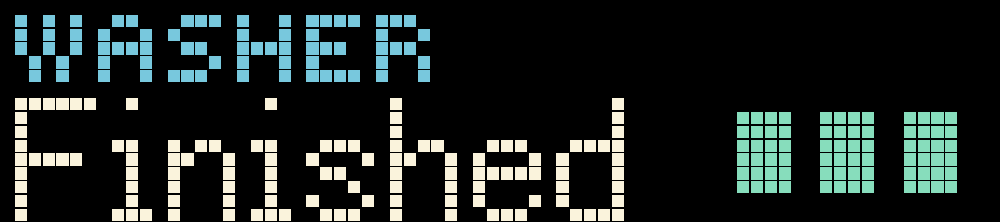

# Laundry Landing

Use a washer's measured power history to separate normal drum pauses from a finished cycle.

A washer often stops drawing much power between parts of a cycle. By waiting for sustained idle power after a real wash, the bar avoids calling you to the machine during a brief pause.

## Distinguish a drum pause from the end

1. Start the companion before the cycle. Configure the washer’s power sensor, active and idle thresholds, and settling time.
2. After the power rises above the active setting, the app can recognize the next sustained idle period. Any increase above the idle threshold interrupts that countdown.
3. Turn from **WASHER** to **LOAD** to check what the sensor is currently reporting.



## Check whether the laundry is ready

1. Turn back to the washer state. **Settling** means the low reading is still being timed. Wait for **Finished** before heading to the appliance.
2. Read the thresholds on the load page if the machine never seems to finish. Compare them with its measured standby draw.
3. Leave the washer state pinned with **Start** if several people check the bar.


## Example from the emulator

The test replayed a 150 W active reading followed by a low load maintained past the 180-second setting. A machine that stayed idle from the first observation would remain in standby, since no active cycle had been observed. Replayed three appliance power measurements through the production state machine.

## Set up the source

Choose the Home Assistant URL and a power sensor in W or kW. Put a read-only-access HA_TOKEN in the companion environment where available. Thresholds active_watts and idle_watts use watts. After observing an active cycle, continuous low power for settle_seconds is required. A mid-cycle wake-up cancels the countdown. Start the companion before the cycle.

## Connect the bar

Copy companion/example.json to a private config.json and adjust it for your source. From the project folder run `python3 companion/serve.py --config config.json`. Use Python 3.10+. Set Local companion URL to `http://127.0.0.1:8770/reading` on the emulator and allow local port 8770. On hardware, bind the companion to a trusted LAN interface and set its reachable address. The wheel browses pages. Click refreshes. Start pins or unpins the current page. The last good reading is labeled offline after a source error.

## Run in the emulator

Open BUSY Bar Emulator. From this repository, run:

```sh
~/.busy-emulator/bin/busy-emulator dev --once
```

Press **Back** to exit.

The GIFs are excerpts from the emulator recording. Each front-display pixel is shown at 9× its original width and height. The end frames pause for reading.

[Full recording](media/controls.mp4) · [Rear display](screenshots/back-1.png) · [Firmware test](EMULATOR-QA.md) · [MIT license](LICENSE)
